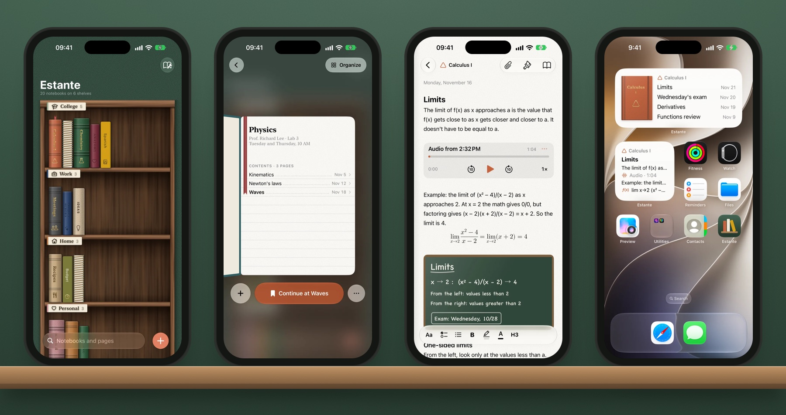

<div align="center">


# Estante

A notes app for iPhone, with your notebooks on a bookcase.

[Website](https://capetinigui.github.io/estante-site/en/) ·
[Help](https://capetinigui.github.io/estante-site/en/help/) ·
[Privacy](https://capetinigui.github.io/estante-site/en/privacy/) ·
[Português](README.md)

</div>

<p align="center">
  
</p>

This repository holds the Estante website: the app's page, the help page
and the privacy policy, in Portuguese and in English. The app is coming
soon to the App Store.

## The app

In Estante, your notebooks sit on a bookcase. Each shelf is for one
subject, like College, Work or Home, and on each shelf you put a notebook
for each topic.

- Write, record audio and photograph the board, all on the same page.
- Tap a notebook and it comes off the shelf, open to the contents.
- On the Home Screen, widgets show a page, a notebook or your tasks.
- No account and no ads. Nothing you write is collected.

## The website

Three pages, in Portuguese and in English: the home page, the help page
and the privacy policy. The help page and the privacy policy are the links
the app shows on the App Store.

They are simple pages, just HTML and CSS:

- no scripts, no fonts from other sites and no visitor counters;
- nothing to generate or compile: what's here is what goes live;
- GitHub Pages publishes every push to `main`;
- the screenshots are of the real app, taken in the iPhone simulator.

## Folders

```text
index.html     the home page
ajuda/         the help page
privacidade/   the privacy policy
en/            the same pages, in English
estilo.css     the look of every page
imagens/       the icon and the app screenshots (English ones in imagens/en/)
.github/       the images in this README
```

## Visit the website

[capetinigui.github.io/estante-site/en](https://capetinigui.github.io/estante-site/en/)

## Contact

[estante.app@icloud.com](mailto:estante.app@icloud.com)

<p align="center"><sub>Made in Brazil. © 2026.</sub></p>
