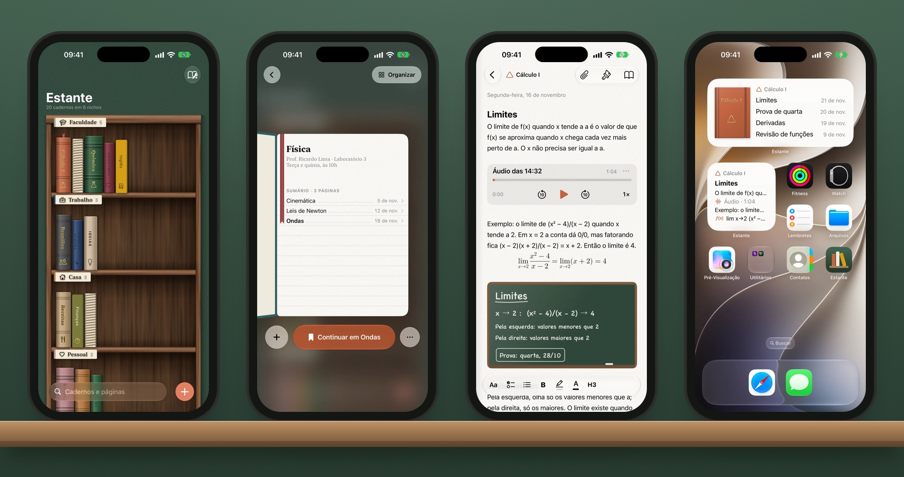

<div align="center">


# Estante

Um app de anotações para iPhone, com os seus cadernos numa estante.

[Site](https://capetinigui.github.io/estante-site/) ·
[Ajuda](https://capetinigui.github.io/estante-site/ajuda/) ·
[Privacidade](https://capetinigui.github.io/estante-site/privacidade/) ·
[English](README.en.md)

</div>

<p align="center">
  
</p>

Este repositório guarda o site do Estante: a página do app, a ajuda e a
política de privacidade, em português e em inglês. O app chega em breve
à App Store.

## O app

No Estante, os seus cadernos ficam numa estante. Cada prateleira é um
nicho, como Faculdade, Trabalho ou Casa, e em cada nicho você coloca um
caderno para cada assunto.

- Escreva, grave áudios e fotografe o quadro, tudo na mesma página.
- Toque num caderno e ele sai da prateleira, aberto no sumário.
- Na Tela de Início, os widgets mostram uma página, um caderno ou as
  suas tarefas.
- Sem conta e sem propaganda. Nada do que você escreve é coletado.

## O site

São três páginas, em português e em inglês: o início, a ajuda e a
política de privacidade. A ajuda e a política são os endereços que o app
mostra na App Store.

São páginas simples, só com HTML e CSS:

- sem scripts, sem fontes de outros sites e sem contadores de visitas;
- sem nada para gerar ou compilar: o que está aqui é o que vai para o ar;
- o GitHub Pages publica cada push na `main`;
- as fotos são telas do app de verdade, tiradas no simulador do iPhone.

## As pastas

```text
index.html     o início
ajuda/         a ajuda
privacidade/   a política de privacidade
en/            as mesmas páginas, em inglês
estilo.css     o visual de todas as páginas
imagens/       o ícone e as fotos do app (as em inglês, em imagens/en/)
.github/       as imagens deste README
```

## Ver no computador

Na pasta do repositório:

```bash
python3 -m http.server
```

Depois, abra http://localhost:8000 no navegador.

## Contato

[estante.app@icloud.com](mailto:estante.app@icloud.com)

<p align="center"><sub>Feito no Brasil. © 2026.</sub></p>
